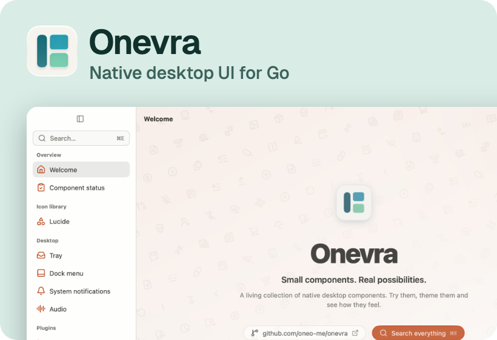
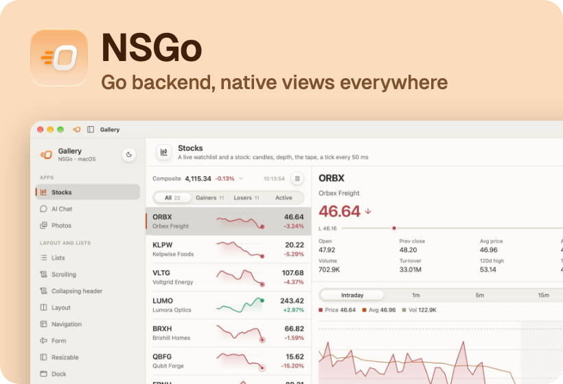
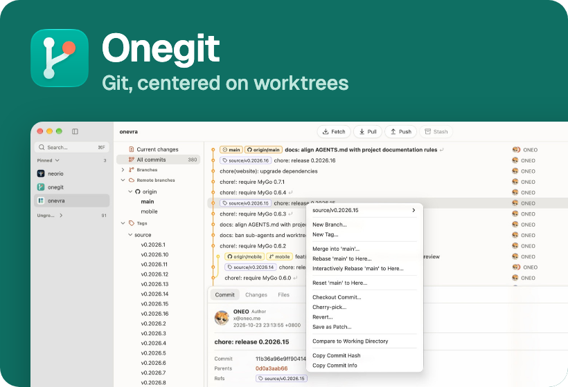
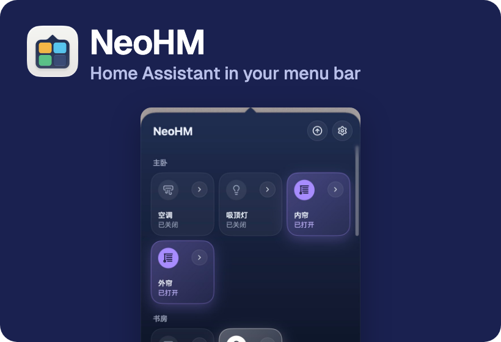

I build native apps and the frameworks underneath them, mostly in Go: fast native UI, plain local files, and tools for working with coding agents.

[Blog](https://oneo.me/) · [X](https://x.com/oneo666) · [Email](mailto:x@oneo.me) · [Sponsor](https://github.com/sponsors/oneo-me)

## Selected work

 

 

**Also**

- [Locus](https://github.com/oneo-me/locus): a local-first Markdown notebook. Notes stay ordinary files, and agents read them through MCP.
- [Manta](https://github.com/oneo-me/manta): a UI toolkit and MVVM framework for Avalonia on .NET.
- [Smile Icons](https://github.com/oneo-me/Smile-Theme): file and folder icons for VS Code and Zed.

**In the workshop**

- A native workspace that runs several coding agents side by side, each task in its own Git worktree, on this machine or any SSH host.
- System-wide voice input with streaming speech recognition, and LLM inference on my own GPU.
- Browser terminals with persistent sessions, and remote app windows streamed over SSH.
